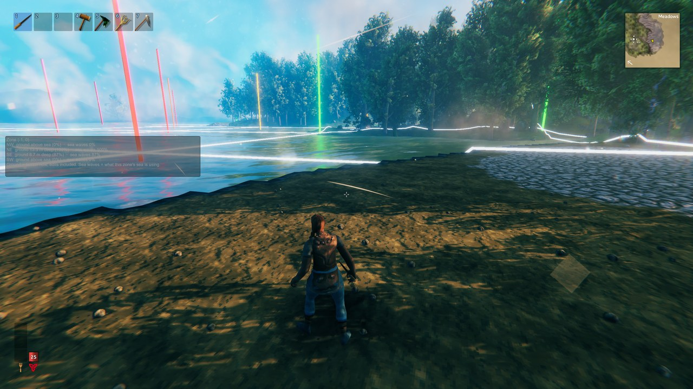
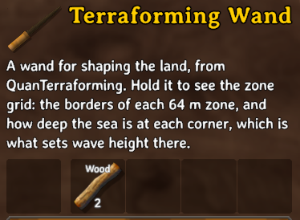
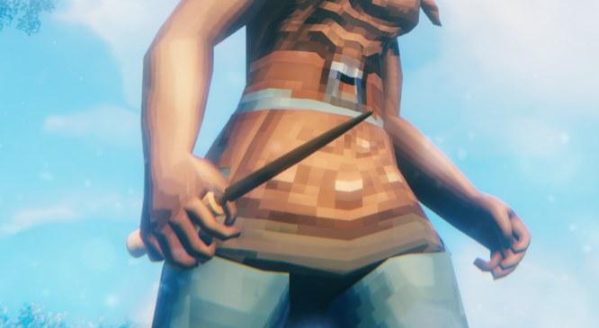

# QuanTerraforming

Terraform coasts, canals and harbours without the game ignoring your work.

- **Waves follow your terrain.** Land you raise out of the sea stops getting waves washing over it.
- **No 8 m limit.** Raise or dig terrain as far as the server allows (200 m by default).
- **The Terraforming Wand.** Hold it to see the zone grid and the corner depths that decide wave height.
  Shaping tools for natural ground and beaches are on the way.

Everyone on a server needs the mod installed: the server and every player connecting to it.

## Waves follow your terrain

In vanilla Valheim the sea's waves never notice terrain edits. Each 64 × 64 m zone scales its waves by the sea
depth at its **four corners**, but it reads those depths once, when the zone loads, before your terrain edits are
applied. So waves always follow the seabed as the world was generated, and land you've raised out of the sea still
gets waves washing over it as if it were open water.

With this mod, the sea re-reads the corners whenever the terrain there changes: when the zone loads, when your edits
arrive, and after every new edit. Raise all four corners of a zone to sea level or above and its water goes flat,
even in a storm. Leave one corner deep and waves blend in from that side. Terrain in the middle of a zone doesn't
count; only the corners do.

> **Tip:** a canal down the middle of a zone never touches a corner. One along a zone border hits a corner every
> 64 m, and each corner is shared by the zones on both sides.

## No 8 m terrain limit

Vanilla only lets you raise or dig terrain 8 m from where the world generated it. This lifts that to the server's
settings, 200 m each way by default. It replaces Heightmap Unlimited JvL; if that mod is installed as well, this part
stands aside and lets it carry on.

> **Switching over from Heightmap Unlimited:** your raised land is stored as those larger height changes. Without
> either mod it shows cut back to 8 m, and an edit there saves the cut. Add this mod and remove that one in the same
> step, with the same limits.

## The Terraforming Wand

<table>
<tr>
<td></td>
<td></td>
</tr>
</table>

| Cost | Crafting station |
|---|---|
| 2 Wood | None: make it from your inventory, like the hammer |

A turned wooden wand: the hammer's grip, a collar, and a long dark-wood body tapering to a blunt tip.

**Hold it to see the zone grid:**
- **White lines** along the zone borders around you.
- **A post at every zone corner**, coloured by its depth:
  - green: at or above sea level, so no waves from that corner
  - yellow to red: deeper; red means 10 m or more (full waves)
  - grey: that zone isn't loaded yet
- **A box on screen** for the zone you're standing in: each corner's ground depth, and the wave strength the zone's
  sea is actually using. With the wave fix on, the two agree.

Put the wand away and the grid goes with it. It doesn't swing or build; the shaping tools will be added to it.

## Settings

| Section | Setting | Default | |
|---|---|---|---|
| `0 - General` | Enabled | On | Synced from the server; admins only. Off is vanilla for everything, including the 8 m limit: see the caution above. |
| `1 - Heightmap` | Upper limit | 200 m | Synced from the server; admins only. How far terrain can be raised. Vanilla is 8. |
| `1 - Heightmap` | Lower limit | 200 m | Synced from the server; admins only. How far terrain can be dug. Vanilla is 8. |
| `2 - Sea` | Waves follow terrain edits | On | Synced from the server; admins only. Off is vanilla. |
| `3 - Zone grid (personal)` | Radius | 3 zones | Personal: how much grid to draw around you. |

## Multiplayer

Install on the server and every client. Wave height drives how boats and floating objects move, and each client
works that out for the objects it controls, so everyone needs the same behaviour.
